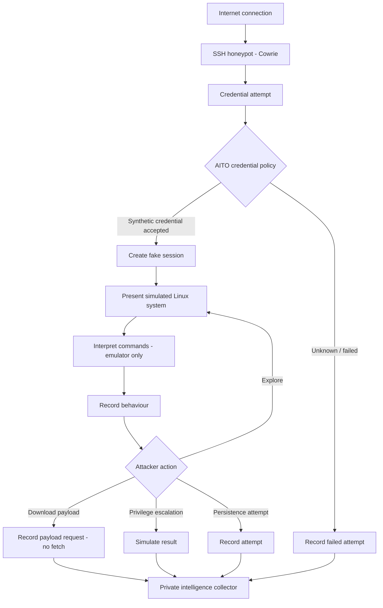

# Deceptive Access

Status: proposed, core feature of the initial product
Applies to: AveDeus sensors, AITO intelligence layer

## 1. Summary

Most SSH honeypots record failed brute-force attempts and stop there. Deceptive
Access goes one step further: when an attacker guesses one of the sensor's
**synthetic** credentials, they are let in to a **completely simulated server**.

They get the *experience* of gaining access. They never get access to a real
machine.

```
Ubuntu 24.04.1 LTS
Linux prod-db-01 6.8.0-45-generic
Last login: Tue Nov 17 16:42:11 2026
root@prod-db-01:~#
```

The attacker believes they have root. In reality:

- there is no root account reachable by them;
- there is no real shell;
- there is no real database;
- there are no real credentials;
- every command is interpreted by a restricted emulator;
- every action is recorded.

The value to AITO is the dataset this produces: **post-compromise behaviour**,
meaning what attackers do in the minutes after they think they have broken in.

## 2. Safety constraints (non-negotiable)

These apply to every PR in the roadmap. A change that weakens any of them is
not mergeable.

1. **No real shell, no real host authentication.**
   - Credential decisions are made by the AITO credential policy inside the
     honeypot process. They never touch PAM, `/etc/shadow`, `sshd`, LDAP or any
     other real authentication system on the host.
   - Commands are interpreted by Cowrie's emulated shell and AITO's simulated
     command handlers. Nothing an attacker types is ever passed to `exec`,
     `subprocess`, `os.system`, a real container, or any other real execution
     path.
   - Cowrie's proxy backend (which relays sessions to a real backend host) is
     not used. The shell backend is the only supported mode.
   - The honeypot runs as an unprivileged user in its own container, with no
     host mounts other than its own log/output volume.

2. **Synthetic secrets are never valid and never resemble usable ones.**
   - Every credential, key, token, password and connection string in a
     deception profile is generated synthetic data that grants nothing,
     anywhere.
   - Synthetic secrets must not match real provider formats closely enough to
     be mistaken for real ones. For example, no `AKIA…`-shaped AWS key IDs, no
     `ghp_…` GitHub tokens, no valid-looking PEM private keys that parse as real
     keys. Values carry an explicit decoy marker such as `FAKE_AITO_` or
     `aito-decoy-`.
   - The profile generator refuses to emit a value that matches a known secret
     pattern, and CI runs a secret scanner over generated profiles and fixtures.
   - The synthetic SSH accounts exist only in the honeypot's credential policy
     file. They are never created as real users on the sensor host.

3. **All outbound actions are simulated and recorded.**
   - `wget`, `curl`, `tftp`, `ftpget`, `scp`/`sftp` to remote hosts, `ssh` to
     other hosts, `nc`, `git clone`, package managers and database/cloud
     clients return locally simulated responses. The requested URL, host,
     port and arguments are recorded; no connection is made.
   - Cowrie's default `wget`/`curl` behaviour of fetching the real URL is
     replaced with simulated handlers. Payload *requests* are recorded; payloads
     are not fetched by the sensor.
   - SSH port forwarding (`direct-tcpip`) is disabled, so the sensor cannot be
     used as a relay.
   - Defence in depth: the sensor's network egress is denied by default, with a
     single allow rule to the private AITO collector.

4. **Deterministic, isolated acceptance.**
   - Whether a credential attempt succeeds depends only on the credential
     policy and the attempt history the honeypot has recorded. Given the same
     policy, seed and history, the decision is the same.

5. **Everything is recorded.**
   - Failed attempts, accepted attempts, every command, every simulated
     outbound request, and session timing all reach the intelligence collector.

## 3. Architecture

### Decision: Cowrie-centred deception with an AITO layer (option A)

Two approaches were considered.

| | A. Cowrie-centred (chosen) | B. Custom AITO shell emulator |
|---|---|---|
| SSH protocol | Cowrie (mature, attacker-facing) | Custom |
| Command handling | Cowrie, extended with AITO handlers | Custom |
| Session recording | Cowrie TTY logs + JSON events | Custom |
| Engineering cost | Lower | Much higher |
| Compatibility | Good, battle-tested | Many edge cases to rebuild |
| Risk of unsafe execution | Low | Higher |
| Control over behaviour | Good via extension points | Full |

**Cowrie handles the dangerous-facing parts**: the SSH protocol and shell
emulation. **AITO supplies** the fictional server personality, synthetic
credential policies, additional simulated services, event correlation and
intelligence.

Option B stays open as a long-term path if Cowrie's extension points become
limiting, but it is not on the initial roadmap.

### Flow



### Components

| Component | Responsibility | Built on |
|---|---|---|
| Credential policy engine | Decides accept/reject for each attempt from synthetic account profiles and policy rules | Custom Cowrie auth class |
| Deception profile | One coherent fictional server: hostname, OS, kernel, users, filesystem, processes, services, network, files | AITO profile format |
| Profile generator | Produces several internally consistent profiles so sensors don't all look identical | AITO tool |
| Profile compiler | Turns a profile into Cowrie artefacts (filesystem pickle, honeyfs contents, txtcmds, config) | AITO tool |
| Simulated command handlers | Commands Cowrie doesn't cover, or must answer from the profile (`docker`, `psql`, `aws`, `systemctl`, outbound tools) | Cowrie command plugins |
| Session recorder | Captures the full session as structured events plus TTY replay | Cowrie output plugin + TTY logs |
| Intelligence collector | Receives events, stores them, derives fingerprints and campaigns | AITO ingestion + database |

## 4. Credential policy

Credentials are not accepted indiscriminately. Each profile defines **synthetic
account profiles**:

| Username | Password | Fake identity |
|---|---|---|
| root | configured synthetic password | System administrator |
| admin | configured synthetic password | Administrator |
| ubuntu | configured synthetic password | Default server user |
| postgres | configured synthetic password | Database administrator |
| deploy | configured synthetic password | Deployment account |

The configured passwords are chosen per profile (typically from common weak
passwords that bots actually try, so that discovery is realistic). They exist
only in the policy file.

Policy rules are configurable per sensor, for example:

- **exact match**: accept only the configured synthetic password for an account;
- **accept after N attempts**: attempts 1 and 2 fail, attempt 3 with a matching
  username succeeds;
- **per-source limits**: an accepted source IP keeps the same credential on
  reconnect, so the illusion is consistent;
- **deny list**: usernames that must always fail.

Every decision is recorded with the rule that produced it, so analysis can
separate "guessed the synthetic password" from "admitted by attempt-count rule".

Example policy (illustrative format):

```yaml
policy:
  seed: prod-db-01
  accounts:
    - username: root
      password_ref: synthetic/root   # resolved from the profile, never a real secret
      identity: System administrator
    - username: deploy
      password_ref: synthetic/deploy
      identity: Deployment account
  rules:
    - type: exact_match
    - type: accept_after_attempts
      usernames: [root, admin, ubuntu]
      attempts: 3
  deny_usernames: []
```

## 5. Levels of deceptive access

| Level | Name | Contents | Roadmap |
|---|---|---|---|
| 1 | Basic access (MVP) | Fake login succeeds; synthetic Linux shell; fake filesystem; simulated users and processes; basic Linux commands | PR 6–8 |
| 2 | Believable server | Fake application deployments; synthetic `.env` files; fake Git repositories; fake database contents; simulated SSH keys; fake cron jobs and services; synthetic cloud configuration | PR 9 |
| 3 | Interactive environment | Simulated privilege escalation; fake Docker containers; fake network discovery; simulated lateral movement; decoy databases and repositories; long-running interactive sessions | PR 9 and PR 13+ |

**Consistency is the key requirement.** If an attacker runs `ls`, `cd`, `cat`,
`ps`, `uname`, `ip addr` and `docker ps`, every answer must describe the same
fictional server. All of them are derived from one deception profile.

## 6. Deception profiles

Each sensor is given one coherent fictional identity. Example: `prod-db-01`.

```
/
├── etc/
│   ├── passwd
│   ├── hostname
│   └── nginx/
├── home/
│   ├── ubuntu/
│   └── deploy/
├── opt/
│   ├── applications/
│   └── backups/
├── var/
│   ├── log/
│   └── www/
├── srv/
│   └── postgres/
└── root/
    ├── .bash_history
    ├── .ssh/
    └── .env
```

All contents are generated synthetic data. A profile defines at least:

- identity: hostname, OS release, kernel version, uptime, timezone;
- users and groups (consistent with `/etc/passwd`, `/home`, `who`, `last`);
- filesystem tree and file contents;
- processes and services (consistent with `ps`, `systemctl`, `top`, `ss`);
- network: interfaces, addresses, routes, neighbouring fictional hosts;
- applications, containers, cron jobs, history files;
- synthetic secrets (see below).

### Synthetic secrets

The fake `.env` is deliberately interesting:

```
APP_ENV=production
DB_HOST=10.20.0.15
DB_NAME=customer_portal
DB_USER=app_service
DB_PASSWORD=synthetic_fake_value
AWS_ACCESS_KEY_ID=FAKE_AITO_ACCESS_KEY
```

Rules (restating safety constraint 2):

- values must never be valid credentials anywhere;
- values must not resemble usable secrets closely enough to be mistaken for
  real ones;
- each value can carry a per-sensor decoy identifier, so that if it is seen
  being used (for example against a simulated service on another sensor) the
  use can be traced back to where it was found.

When an attacker uses a found secret, for example `psql -h 10.20.0.15` or
`aws s3 ls`, the simulated command handler answers locally from the profile and
records the attempt. No connection leaves the sensor.

### Profile generator

The network should not look like the same honeypot repeated everywhere. The
generator produces several internally consistent profiles (for example a
database server, a CI runner, a web frontend, a staging box) from templates and
a seed. Same seed, same profile. The generator validates each profile for
internal consistency and runs the synthetic-secret checks before it can be
deployed.

## 7. Intelligence

Instead of only recording:

```
192.0.2.10 attempted root login
```

AITO records, per session:

- which credentials were tried;
- which credential gained synthetic access, and by which policy rule;
- what commands were executed, in order, with timing;
- how long the session lasted;
- which directories and files they looked at;
- what they searched for;
- which tools they tried to install;
- whether they attempted persistence (cron, `authorized_keys`, systemd units, rc files);
- whether they attempted to download malware (URLs recorded, not fetched);
- whether they attempted to discover or reach other machines.

From full sessions AITO builds **behavioural fingerprints** of attackers, and
from fingerprints it correlates sessions into **campaigns**.

Headline research metric: **post-compromise behaviour**, meaning what attackers
do immediately after obtaining apparent access.

### Event types (additions to the event schema)

| Event | Key fields |
|---|---|
| `auth.attempt` | session, src, username, password hash/class, decision, rule |
| `session.start` / `session.end` | session, src, profile id, account, duration |
| `command.input` | session, raw input, parsed command, args, handler |
| `fs.access` | session, path, operation (read/list/write/delete) |
| `outbound.simulated` | session, tool, destination host/URL/port, simulated response |
| `privesc.simulated` | session, technique, simulated outcome |
| `persistence.attempt` | session, mechanism, target path/unit |
| `secret.accessed` / `secret.used` | session, decoy id, where found / where used |

Exact field names are fixed in the event schema PR; this table defines the
intent.

## 8. Open questions

- Retention and handling for recorded sessions that contain attacker-supplied
  data (credentials attackers bring with them, URLs, uploaded files).
- Whether files attackers upload via SFTP/SCP are kept, and if so how they are
  quarantined.
- How many profiles per sensor and how often to rotate them.
- Legal/hosting review for each region sensors are deployed in.
