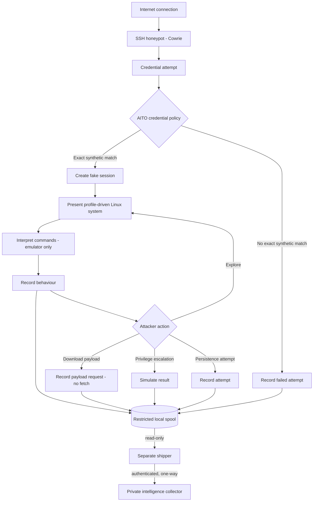

# Deceptive Access

Status: architectural baseline, revised after review
Applies to: AveDeus sensors, AITO intelligence layer

> **Defining engineering rule of BearJug**
>
> Make the deception as convincing as possible to the attacker, while making
> the real infrastructure as inaccessible as possible to them.

## 1. Summary

Most SSH honeypots record failed brute-force attempts and stop there. Deceptive
Access goes one step further: when an attacker presents one of a sensor's
**synthetic** credentials, they are let in to a **completely simulated server**.

They get the *experience* of gaining access. They never get access to a real
machine.

```
Ubuntu 24.04.1 LTS
Linux prod-db-01 6.8.0-45-generic
Last login: Tue Nov 17 16:42:11 2026
root@prod-db-01:~#
```

The attacker believes they have root. In reality:

- there is no root account reachable by them;
- there is no real shell;
- there is no real database;
- there are no real credentials;
- every command is interpreted by a restricted emulator;
- every action is recorded.

The value to AITO is the dataset this produces: **post-compromise behaviour**,
meaning what attackers do once they believe they have broken in.

### The longer-term opportunity

Each sensor becomes a fictional environment with its own identity, and sensors
can together form a fictional network. An attacker might:

1. discover a fake web server;
2. find credentials in a fake deployment file;
3. use them to access a fake database;
4. discover another fictional machine;
5. attempt to download malware or establish persistence;
6. return days later and continue exploring.

AITO records the entire chain and compares behaviour across sensors to identify
recurring techniques and campaigns. That is a far more valuable research
platform than a collection of IP addresses and failed passwords.

## 2. Safety constraints and the security boundary

These apply to every PR. A change that weakens any of them is not mergeable.
They are **enforced by executable tests and by the network**, not only by
configuration.

### 2.1 Constraints

1. **No real shell, no real host authentication.**
   - Credential decisions are made by the AITO credential policy inside the
     honeypot process. They never touch PAM, `/etc/shadow`, `sshd`, LDAP or any
     other real authentication system.
   - Commands are interpreted by Cowrie's emulated shell and AITO's simulated
     command handlers. Attacker input is never passed to `exec`, `subprocess`,
     `os.system`, a real container, or any other real execution path.
   - Cowrie's proxy backend is not used. The emulated shell backend is the only
     supported mode.
   - Synthetic accounts exist only in the credential policy. They are never
     created as real users on the sensor host.

2. **Synthetic secrets are never valid and never resemble usable ones.**
   - Every credential, key, token, password and connection string in a
     profile grants nothing, anywhere.
   - Values must not match real provider formats closely enough to be mistaken
     for real ones by provider validators or secret scanners: no value that
     passes a real provider's format or checksum, no PEM blocks that parse as
     real keys.
   - Values must not advertise the product either. The displayed value and
     AITO's internal decoy identity are separate (section 5.3).
   - The profile tooling refuses to emit a value matching a known real secret
     pattern, and CI runs a secret scanner over profiles and fixtures.

3. **All outbound actions are simulated and recorded.**
   - `wget`, `curl`, `tftp`, `ftpget`, `scp`/`sftp` to remote hosts, `ssh` to
     other hosts, `nc`, `git clone`, package managers and database/cloud
     clients return locally simulated responses. The requested URL, host, port
     and arguments are recorded; no connection is made.
   - Cowrie's default real-fetch `wget`/`curl` behaviour is replaced.
   - SSH port forwarding (`direct-tcpip`, `tcpip-forward`) is disabled.

4. **Deterministic, isolated acceptance.** See section 4.

5. **Everything is recorded**, as raw evidence first (section 8).

### 2.2 Isolation (defence in depth)

The network and the container must hold the boundary **even if Cowrie or an
AITO plugin is misconfigured**.

- The honeypot runs as an unprivileged user in its own container, with a
  read-only root filesystem, dropped capabilities and no-new-privileges.
- No host mounts other than its own output volume and the upload quarantine
  directory. No Docker socket. No access to collector internals, credentials
  or configuration.
- Network egress from the honeypot is denied by default at the firewall; the
  honeypot process has no route out at all.
- Inbound is limited to the SSH listener.

### 2.3 Sensor-to-collector shipping boundary

Shipping is a **distinct component**, not a loosely defined sidecar:

1. The honeypot writes evidence to a restricted local **spool** (write-only
   for the honeypot, read-only for the shipper apart from removing files the
   collector has acknowledged; see [ingestion.md](../ingestion.md)).
2. A separate **shipper** process, in its own container, reads the spool.
3. The shipper authenticates to the collector; it is the only thing on the
   sensor allowed to reach the collector endpoint.
4. The collector never opens or provides a route back into the sensor.
5. The shipper treats spool contents as opaque data: it never executes,
   parses as code, or interprets attacker-supplied content.

### 2.4 Security boundary tests

PR 5 introduces a security test suite that runs in CI against a real sensor
container. Each guarantee is a test that must pass.

**Status: specified, not yet implemented.** Until these tests exist and pass in
CI, none of these guarantees should be treated as proven.

| Guarantee | Test |
|---|---|
| Simulated `curl` cannot contact an external server | Run `curl http://<test-sink>/` in a session; assert the sink received nothing and a `outbound.simulated` event was recorded |
| Simulated `wget` cannot retrieve a payload | Run `wget` against a test sink serving a file; assert no request at the sink and no payload on disk |
| SSH forwarding cannot establish a connection | Open `direct-tcpip` and remote forward channels from the client; assert they are refused and nothing reaches the sink |
| Commands cannot invoke host processes | Run commands that would create marker files or processes if executed for real (including shell metacharacters, `$(…)`, backticks, `bash -c`, `python -c`); assert no host-side effect |
| Uploaded files cannot escape quarantine | SFTP/SCP uploads with path traversal (`../`, absolute paths, symlinks); assert files land only in quarantine, with sanitised names |
| No access to host mounts, Docker socket or collector internals | From inside the honeypot container, assert the socket and host paths are absent and collector endpoints are unreachable from the honeypot process |
| Egress firewall holds without Cowrie's help | With a deliberately misconfigured plugin that tries a real connection, assert the firewall blocks it |
| Synthetic secrets are not real-shaped | Secret scanner over all profiles and fixtures reports nothing |
| Shipper boundary holds | Collector cannot open a connection to the sensor; shipper never executes spool content (spool seeded with executable payloads and shell metacharacters) |

A failing boundary test blocks merge.

## 3. Architecture

### Decision: Cowrie-centred deception with an AITO layer (option A)

| | A. Cowrie-centred (chosen) | B. Custom AITO shell emulator |
|---|---|---|
| SSH protocol | Cowrie (mature, attacker-facing) | Custom |
| Command handling | Cowrie, extended with AITO handlers | Custom |
| Session recording | Cowrie TTY logs + JSON events | Custom |
| Engineering cost | Lower | Much higher |
| Compatibility | Good, battle-tested | Many edge cases to rebuild |
| Risk of unsafe execution | Low | Higher |
| Control over behaviour | Good via extension points | Full |

**Cowrie handles the dangerous-facing parts**: the SSH protocol and shell
emulation. **AITO supplies** the fictional server profile, synthetic credential
policy, additional simulated services, event correlation and intelligence.
Option B stays open as a long-term path but is not on the roadmap.

### Flow



The honeypot only writes to the spool. The shipper is the only component that
reaches the collector, and nothing routes back into the sensor (section 2.3).

### Components

| Component | Responsibility | Built on |
|---|---|---|
| Credential policy engine | Accept/reject each attempt by exact match against the active profile's synthetic accounts | Custom Cowrie auth class |
| Deception profile | Complete fictional server specification (section 5) | AITO profile data model |
| Profile generator | Produces several distinct, internally consistent profiles | AITO tool |
| Profile compiler | Turns a profile into Cowrie artefacts (filesystem, file contents, command outputs, config) | AITO tool |
| Simulated command handlers | Commands that must answer from the profile (`docker`, `psql`, `aws`, `systemctl`, outbound tools) | Cowrie command plugins |
| Session recorder | Full session as raw evidence, written to the local spool | Cowrie output plugin + TTY logs |
| Shipper | Reads the spool and ships evidence to the collector; no route back in | Separate AITO component |
| Intelligence collector | Stores evidence, normalises events, derives intelligence | AITO ingestion + database |

## 4. Credential policy

### 4.1 Production rule: exact synthetic matches only

A login succeeds **only** when the username and password exactly match a
synthetic account in the sensor's active profile. Trying the same username
repeatedly never grants access. This keeps "the attacker discovered a
credential" a real, measurable event.

- **Exact synthetic username/password match.** No other rule grants access in
  the default policy.
- **Per-profile credential sets.** Each fictional server profile has its own
  accounts and passwords. Two sensors running different profiles accept
  different credentials.
- **Consistent across reconnects.** The same credentials give the same result
  every time, from any source, for as long as the profile is active. A
  credential that worked yesterday still works today; one that failed still
  fails.
- **Deterministic and isolated.** The decision depends only on the profile's
  credential set (and, for experiments, the declared experimental policy). It
  never depends on the host's authentication system.

Example synthetic accounts for a `prod-db-01` profile:

| Username | Password | Fictional identity |
|---|---|---|
| root | profile-specific synthetic password | System administrator |
| ubuntu | profile-specific synthetic password | Default server user |
| postgres | profile-specific synthetic password | Database administrator |
| deploy | profile-specific synthetic password | Deployment account |

Synthetic passwords are typically drawn from weak passwords that bots really
try, so that discovery is realistic. They exist only in the profile.

### 4.2 Experimental policies

Other acceptance behaviours (for example "accept after N attempts") are **not**
ordinary authentication rules. They may be enabled only as **controlled
experimental policies**:

- explicitly configured per sensor with an experiment id, start and end date;
- every `auth.attempt` and `session.start` event carries
  `policy.kind = "experimental"` and the experiment id;
- analysis separates experimental admissions from genuine credential discovery
  by default;
- still deterministic and isolated, and still bound by every safety constraint.

Every decision event records which rule produced it.

## 5. Deception profiles as a first-class data model

A profile is a **complete fictional server specification**. Everything the
attacker can observe is derived from it: `uname`, `ps`, `ls`, `cat`,
`systemctl`, `ip addr`, `docker ps`, database clients and simulated network
neighbours must all tell the same story.

### 5.1 Example: production database profile

| Property | Fictional value |
|---|---|
| Hostname | prod-db-01 |
| OS | Ubuntu Server 24.04.1 LTS, kernel 6.8.0-45-generic |
| Main service | PostgreSQL |
| Users | root, ubuntu, postgres, deploy |
| Applications | Customer portal |
| Internal network | 10.20.0.0/24 |
| Decoy files | `.env`, backups, Git repositories |
| Decoy secrets | Plausible, non-functional values tracked by internal decoy id |
| Credential set | Synthetic accounts for this profile only |

### 5.2 What a profile specifies

- **Identity**: hostname, OS release, kernel, uptime model, timezone, locale.
- **Accounts**: users, groups, home directories, shells, synthetic credentials.
- **Filesystem**: tree, file contents and metadata (owners, modes, timestamps).
- **Processes and services**: what `ps`, `top`, `systemctl`, `ss` and `netstat` show.
- **Network**: interfaces, addresses, routes, DNS, and fictional neighbouring hosts.
- **Applications**: deployments, config, containers, cron jobs, logs, Git repositories.
- **Decoy data**: database contents, backups, history files.
- **Decoy secrets**: displayed values plus their internal decoy ids (section 5.3).
- **Links**: references to other fictional machines (for example the DB host in
  a web server's `.env`), so profiles can form a fictional network.

Example layout for `prod-db-01`:

```
/
├── etc/
│   ├── passwd
│   ├── hostname
│   └── nginx/
├── home/
│   ├── ubuntu/
│   └── deploy/
├── opt/
│   ├── applications/
│   └── backups/
├── var/
│   ├── log/
│   └── www/
├── srv/
│   └── postgres/
└── root/
    ├── .bash_history
    ├── .ssh/
    └── .env
```

Example decoy `.env`:

```
APP_ENV=production
DB_HOST=10.20.0.15
DB_NAME=customer_portal
DB_USER=app_service
DB_PASSWORD=<generated, plausible, non-functional>
AWS_ACCESS_KEY_ID=<generated, plausible, fails provider validation>
```

When an attacker uses a found secret, for example `psql -h 10.20.0.15` or
`aws s3 ls`, the simulated handler answers from the profile and records the
attempt. No connection leaves the sensor.

### 5.3 Decoy secrets: internal identity vs displayed value

A decoy secret has two parts:

- **Internal decoy identity**: a unique id AITO uses to track where the secret
  was planted, seen and used. It lives only in AITO's decoy registry and never
  needs to appear anywhere in the simulated server.
- **Displayed synthetic value**: what the attacker sees. It should look
  ordinary in context (no product names, no `FAKE` markers), but it must be
  incapable of authenticating anywhere real, and must fail real provider
  format or checksum validation so secret scanners and providers never treat
  it as live.

Simulated services recognise displayed values by looking them up in the
registry, so reuse of a decoy on another sensor or service resolves to its
decoy id and links the sessions. The exact generation rules per secret type
(passwords, database URLs, cloud keys, SSH keys, API tokens) are settled in
PR 9, and every rule must pass the secret checks below.

### 5.4 Generator and validation

The profile generator builds whole fictional environments, not isolated fake
files: several distinct server types (database, web frontend, CI runner,
staging box) from templates and a seed. Same seed, same profile. Before a
profile can be deployed it must pass:

- **consistency checks**: users, processes, services, network and files agree
  with each other;
- **secret checks**: every displayed value is registered to a decoy id, none
  passes real provider validation, and none names the product;
- **distinctness checks**: sensors in the network don't share a fingerprintable
  profile.

### 5.5 Levels of deceptive access

| Level | Name | Contents | Roadmap |
|---|---|---|---|
| 1 | Basic access (MVP) | Fake login succeeds; profile-driven shell; fake filesystem; simulated users and processes; basic commands | PR 6–8 |
| 2 | Believable server | Applications, decoy `.env`, Git repositories, database contents, SSH keys, cron jobs and services, cloud configuration | PR 9 |
| 3 | Interactive environment | Simulated privilege escalation, Docker, network discovery, lateral movement across fictional machines, decoy databases and repositories, long-running and returning sessions | PR 9 and 13+ |

## 6. Intelligence signals

Per session and across sessions, AITO captures:

- which credentials were tried, and which one gained synthetic access (and by which rule);
- commands executed, in order;
- **time between commands**;
- **failed versus successful simulated operations**;
- **search patterns and files of interest**;
- **likelihood of automation** (from timing, input cadence, command batching
  and paste patterns), recorded as `automation_likelihood`, `confidence` and
  `supporting_signals`, never as a definitive human/bot label;
- tools they tried to install;
- **credential reuse between sessions**, including reuse of decoy secrets;
- **persistence attempts** (cron, `authorized_keys`, systemd units, rc files);
- malware download attempts (URLs recorded, never fetched);
- **attempts to discover other fictional machines**;
- **recurrence**: sessions that may come from the same actor (see below);
- session duration.

From full sessions AITO builds **behavioural fingerprints**, and from
fingerprints it correlates sessions into **campaigns**. Headline research
metric: **post-compromise behaviour**.

### Recurrence is not identity

An IP address is not an identity: attackers change addresses, use proxies,
share infrastructure and sit behind NAT. AITO keeps these links distinct:

| Link | Meaning |
|---|---|
| Source-IP recurrence | Same source address seen again; weakest signal |
| Behavioural similarity | Similar fingerprints across sessions |
| Credential or decoy-secret reuse | A credential or decoy found in one session is used in another |
| Probable campaign association | Several signals together suggest a shared operator or tooling |
| Confirmed same-session identity | Events within one SSH session; the only certain link |

Every relationship and classification is stored with a **confidence** and its
**supporting evidence** (references to the events that justify it), never as
certainty.

## 7. Event types (normalised tier)

| Event | Key fields |
|---|---|
| `auth.attempt` | session, src, username, password reference (see 8.2), decision, rule, policy kind, experiment id |
| `session.start` / `session.end` | session, src, profile id, account, duration, source-recurrence flag |
| `command.input` | session, sequence, parsed command, args, handler, time since previous command |
| `command.result` | session, sequence, simulated outcome (success/failure), error class |
| `fs.access` | session, path, operation (read/list/search/write/delete) |
| `outbound.simulated` | session, tool, destination host/URL/port, simulated response |
| `discovery.attempt` | session, technique, fictional target |
| `privesc.simulated` | session, technique, simulated outcome |
| `persistence.attempt` | session, mechanism, target path/unit |
| `secret.accessed` / `secret.used` | session, decoy id, where found / where used |
| `upload.received` | session, quarantine reference, size, hash |

Exact field names are fixed in the canonical event schema (PR 1–2).

## 8. Data model: evidence, events, intelligence

### 8.1 Three tiers

| Tier | Examples | Properties |
|---|---|---|
| Raw evidence | TTY recordings, authentication attempts, command input, uploaded files | Append-only, integrity-checked (hashes), never rewritten by analysis |
| Normalised events | Parsed commands, file access, simulated connections | Derived from raw evidence; can be regenerated when parsers change |
| Intelligence | Behavioural fingerprints, campaign relationships, classifications | Derived from normalised events; versioned by analysis engine |

Analysis can be revised and re-run at any time without losing the original
evidence. Every derived record points back to the evidence it came from.

### 8.2 Attacker-supplied passwords

- Default: **keyed hashes** for correlation, plus coarse features (length,
  character classes, membership in known wordlists). Normalised events and
  intelligence never hold plaintext.
- Plaintext is kept only if a specific research need justifies it, only in
  raw evidence, encrypted at rest, for a very short fixed period, with access
  restricted to named roles.
- Every access to and deletion of plaintext evidence is audited.

### 8.3 Uploaded files

- Uploads land in a quarantine directory outside anything the honeypot can
  execute or serve, with sanitised names, content-addressed by hash.
- Quarantined files are never executed, opened by the sensor, or fetched to
  analyst machines without explicit handling. Access is restricted and logged.
- Explicit size limits, retention period and deletion process; retrieval and
  deletion are audited.

### 8.4 Decision required before public sensors

The retention policy is drafted in PR 3–4 but must be **decided before any
public sensor is deployed**, answering: how long raw passwords are kept;
whether plaintext is needed at all; who can retrieve uploaded files; and how
access and deletion are audited.

## 9. Release gate: first end-to-end test

The first successful end-to-end test is a **formal release gate** for the MVP.
In CI, against a real sensor and collector:

1. an external test client connects over SSH;
2. it authenticates using a synthetic credential (exact match);
3. it explores the fake server (`uname`, `ls`, `cat`, `ps`, `ip addr`) and gets
   consistent answers from the profile;
4. it attempts a simulated download;
5. the collector holds a complete investigation record: raw evidence,
   normalised events and a session summary;
6. **no external connection** was made and **no real command** was executed,
   proven by the security boundary tests running alongside.

## 10. Delivery approach

Don't implement all the deception features at once. First get the event
schema, an isolated sensor and the collector working. Then prove the
fake-login-to-fake-shell experience through the release gate. Only then add
Level 2 and Level 3 complexity.

## 11. Open questions

- Exact retention periods and access roles (must be decided before public
  sensors, see 8.4).
- How many profiles per sensor, and how often to rotate them.
- Rules for running experimental credential policies (who approves, how long).
- Legal and hosting review for each region sensors are deployed in.
